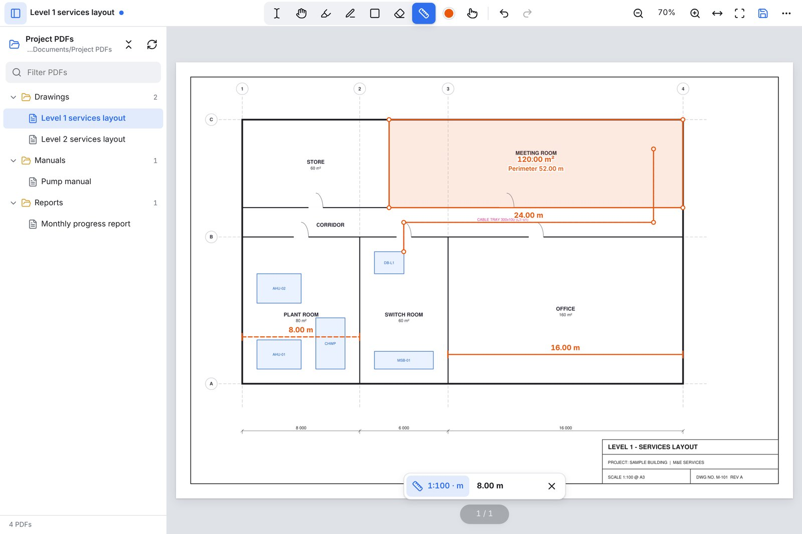

<p align="center"></p>

# Eagles PDF viewer

A fast PDF reader and markup app for Windows tablets like the Surface Pro, for touch, pen and mouse. It lists every PDF in a folder (including subfolders) down the left, opens up to four PDFs side by side (each one fully editable), merges PDFs, lets you delete, add, copy in, move and rotate pages, copies any part of a page as a picture you can paste back at the same size, finds words in a PDF, lists every markup, saves by itself if you want, and lets you highlight, write and draw on them, add boxes, arrows, clouds, callouts and text, sign them, copy text, and measure distances and areas on scaled drawings. Draw a lasso round markups (or hold the pen's side button) to move, resize, copy or delete several at once. You can also erase parts of a page or retype a line of its text, and embed your markups so they can no longer be moved. Everything you add is saved into the PDF itself.

### ⬇ [Download Eagles PDF viewer for Windows (EaglesPDF-Setup.zip, 5 MB)](https://github.com/RukasuRi-96/PDF-windowsSurfaceViewer/raw/main/downloads/EaglesPDF-Setup.zip)

Then extract the zip and double-click **Install Eagles PDF viewer** ([step by step](#install)). The link works without signing in to GitHub, and the installed app keeps itself up to date from this repository. Setup fetches the Electron runtime from Electron's official GitHub releases and checks its fingerprint.



**Current version: 1.11.1** · Windows 10 or 11, 64-bit

- [Install](#install)
- [Getting started](#getting-started)
- [Keyboard shortcuts](#keyboard-shortcuts)
- [Troubleshooting](#troubleshooting)
- [For developers](#for-developers)

## Install

You need Windows 10 or 11 on a 64-bit Intel or AMD PC, such as a Surface Pro 9 with an Intel Core i5 or i7. You also need an internet connection while setup runs, and you don't need administrator rights.

1. Download **[`EaglesPDF-Setup.zip`](https://github.com/RukasuRi-96/PDF-windowsSurfaceViewer/raw/main/downloads/EaglesPDF-Setup.zip)** (about 5 MB). The link downloads it straight away. You can also find it in the [`downloads` folder](downloads/EaglesPDF-Setup.zip) (click the **Download raw file** button ↓ there). Don't use the green **Code → Download ZIP** button; that gives you the source code, not the installer.
2. Right-click the zip and choose **Extract All…**, then **Extract**. Setup doesn't work from inside the zip.
3. The extracted folder holds **Install Eagles PDF viewer**, **README** and a **files** folder. Double-click **Install Eagles PDF viewer**.
   - Its full name is `Install Eagles PDF viewer.cmd`, but Windows usually hides the `.cmd` ending.
   - If Windows shows *"Windows protected your PC"*, click **More info**, then **Run anyway**. This appears because the app isn't code-signed.
   - If **Install Eagles PDF viewer** is missing (some antivirus or company policies remove `.cmd` files), open the **files** folder, right-click **setup** (`setup.ps1`) and choose **Run with PowerShell**.
4. A setup window opens and does three things:
   - it downloads the app's runtime (about 160 MB) from Electron's official GitHub releases;
   - it checks the download's SHA-256 fingerprint;
   - it installs everything to `%LOCALAPPDATA%\Programs\Eagles PDF viewer`.

   This takes a minute or two. Eagles PDF viewer then opens by itself, and it's on your **Start menu** and **Desktop**.

### Make it your default PDF app (optional)

Right-click any PDF in File Explorer and choose **Open with**, then **Choose another app**, then **Eagles PDF viewer**, then **Always**.

### Update

From version 1.10.0 the app **updates itself**:

> **On 1.10.x?** Those versions download updates but can't install them: after **Restart now** the app closes and doesn't come back. Install 1.11.1 or later once by hand (below); from then on updates install themselves.


- A few seconds after it starts (and every few hours), it looks for a new version. When there is one, a message says so and a dot appears on the **⋯** button.
- Click **Update…** on the message, or **⋯ → Update to version …**, to see what's new and choose **Update now**. You can also check yourself any time with **⋯ → Check for updates**.
- The update is downloaded (usually about 5 MB) and checked against its SHA-256 fingerprint. Then choose **Restart now**, or **When I close the app** to have it installed when you close Eagles. It reopens by itself after a restart.
- Your settings, signatures, shortcuts, toolbar and open PDFs are kept. If a future version needs a new app runtime, the installer window opens to finish the update.
- The app closes only once its installer helper is running, and the next start says whether the update took. If an update ever can't install itself, a message says so, shows what happened, and offers the installer (**Get the installer**). Nothing is changed in that case.
- To stop it looking by itself, untick **Look for updates automatically** in the update window.

Updates come from this repository's [`downloads`](downloads) folder: [`latest.json`](downloads/latest.json) names the newest version and its fingerprint, and the installer zip it points to holds the app.

Before 1.11.1, or to reinstall: download the new `EaglesPDF-Setup.zip` and run its **Install Eagles PDF viewer** the same way. Your settings, drawing scales and last-opened file are kept.

### Uninstall

Go to **Settings**, then **Apps**, then **Installed apps**. Click **⋯** next to **Eagles PDF viewer** and choose **Uninstall**. Your PDFs are not touched.

### Other ways to install

- **No internet during setup, or GitHub is blocked on your network:** use the complete package **`EaglesPDF-win-x64.zip`** (about 150 MB) from the [Releases page](https://github.com/RukasuRi-96/PDF-windowsSurfaceViewer/releases) once it has been published there (see [Publish a version](#publish-a-version)), or build it yourself (see [Build the Windows app](#build-the-windows-app)). It already contains the runtime. Extract it and double-click **`Install.cmd`**.
- **Surface Pro 9 with 5G (Microsoft SQ3, ARM):** the x64 version runs through Windows 11's built-in emulation. For full speed, build the ARM version (`node tools/build-win.js arm64`, see [Build the Windows app](#build-the-windows-app)) and install it with `Install.cmd`.

## Getting started

### 1. Open your PDFs

- Click **Open folder** and pick the folder where your PDFs live. You can also use **⋯ → Open folder…** or **Ctrl+O**.
  - Every PDF in that folder and all its subfolders appears in the list on the left.
  - The list updates by itself when files are added or removed.
- Type in **Filter PDFs** (**Ctrl+F**) to find a file by name.
- Click or tap a file to open it. **Alt+↓** and **Alt+↑** move to the next and previous PDF in the list.
- You can also drag a PDF or a folder onto the window, use **⋯ → Open file…**, or open PDFs from File Explorer once it's your default app.
- Right-click a file in the list for **Show in folder** and **Copy path**.
- Drag the list's edge to resize it, or hide it with the button at the top left (**Ctrl+B**).
- The app remembers where you were in each file and reopens the last one when it starts.

### 2. Move around

| | Pan | Zoom | Other |
|---|---|---|---|
| **Finger** | Drag; flick to glide | Pinch | Double-tap to zoom in, or back to fit width |
| **Mouse** | Middle-button drag, with any tool | Ctrl+wheel; the zoom buttons; click the **%** for presets | The wheel scrolls (or zooms, see below) |
| **Keyboard** | Arrow keys, PgUp/PgDn, Space | Ctrl + / Ctrl − | Ctrl+0 fits width, Ctrl+9 fits page, Home/End jump to the first/last page |

To jump to a page, click the page counter at the bottom of the screen and type a page number, or a page name such as `A-101` if the PDF has them (see [page names](#page-names)).

**Mouse wheel: scroll or zoom.** Open the **⋯** menu (or the **%** zoom menu) and choose **Mouse wheel scrolls** or **Mouse wheel zooms**.
- In zoom mode, the wheel zooms around the pointer, and Shift+wheel scrolls.
- Ctrl+wheel and touchpad pinch always zoom.

### 3. The tools

The toolbar holds the tools. The eagle at the top left is the app's icon.

| Tool | Key | What it does |
|---|---|---|
| **Select** | V | Tap or drag any markup to select it, then move, reshape, retype, restyle or delete it. Drag over text to select and copy it. Dragging on blank paper pans. |
| **Pan** | H | Drag to move around. |
| **Highlight** | M | Two ways, chosen in its colour menu (tap the tool again): **Words** snaps to the text you sweep over (where there's no text it becomes a freehand marker); **Draw** is a freehand marker wherever you draw, even over text. A small **~** on the tool means Draw. |
| **Pen** | P | Write or draw freehand. |
| **Shapes** | B | Box, line, arrow, cloud, callout or text. Tap the tool again (or its small ▾) to choose. It always draws, even on top of other markups. See [Shapes, text and callouts](#4-shapes-text-and-callouts). |
| **Signature** | S | Place your signature, with its background removed. See [Sign](#5-sign). |
| **Eraser** | E | Removes the ink, shapes, text, signatures, highlights, pictures and measurements you touch. |
| **Lasso** | L | Draw round markups, or over them, to select them all; then move, resize, copy, paste, duplicate or delete them together. The pen's side button does the same with any tool. See [Lasso](#11-lasso-select-several-markups). |
| **Snip** | C | Drag a box, or draw around something, to copy it as a picture. Then **tap** where it should go (or press **Ctrl+V**): it's pasted at exactly the same size, as a picture you can move and resize. See [Snip](#9-snip-copy-part-of-a-page-as-a-picture). |
| **Edit content** | X | Drag a box to erase an area of the page; tap a line of the page's own text to retype it. See [Edit the page's content](#6-edit-the-pages-content). |
| **Measure** | R | Distance, path length and area at the drawing's scale (see below). |
| **Pages** (top right) | Ctrl+Shift+P | Thumbnails of every page: delete, add blank pages, copy in pages from another PDF, duplicate, move and rotate. See [Pages](#7-pages-delete-add-copy-in-move-rotate). |

- **Colors and thickness:** tap the active tool again, or tap the colored dot next to the tools.
- **Pen and finger:** the pen uses the selected tool, and a finger always pans and zooms. To draw with a finger, turn on the **finger button** (**T**); you then pan and zoom with two fingers.
- **Writing with the pen:** strokes get thinner or thicker with pen pressure, like ink (turn this off in the Pen tool's colour menu). While the pen hovers, a dot in the ink's colour and size shows where it will write. Ink appears with very little delay and keeps the exact shape you wrote.
- **Erasing with the pen:** flip the Surface Pen over and use its eraser end (its top button).
- **Selecting with the pen:** hold the pen's **side button** and draw round markups: they're selected whatever tool you're using (see [Lasso](#11-lasso-select-several-markups)).
- **Choose what the toolbar shows:** **⋯ → Customize the toolbar…** (or right-click the toolbar, or press and hold it). Tick the buttons you want: every tool, colour and size, finger draws, undo, redo, paste, search, the zoom buttons, open side by side, full screen, the Pages and Markups panels, autosave and save. When it shows a lot, the buttons get smaller so everything fits and nothing overlaps; you can also pick a button size. Anything you hide is still in the **⋯** menu and on its keyboard shortcut.
- **Palm rejection:** your palm is ignored while the pen is near the screen.
- **Undo and redo:** Ctrl+Z and Ctrl+Y, or the arrows in the toolbar.

### 4. Shapes, text and callouts

Choose the **Shapes** tool (**B**), then tap it again (or its small ▾) to pick a shape, its color and its thickness.

| Shape | How to draw it |
|---|---|
| **Box** | Drag from corner to corner. |
| **Line** / **Arrow** | Drag from start to end; the arrow points where you finish. **Shift** keeps it at 0°, 45° or 90°. |
| **Cloud** | Drag from corner to corner. Good for marking revisions on drawings. |
| **Callout** | Drag from the spot you're pointing at to where the text should go, then type. The leader line and arrow are added for you. |
| **Text** | Tap where the text should start, or drag to set how wide it is, then type. |

- While typing, **Enter** finishes (so does **Done**, or tapping anywhere else on the page). **Shift+Enter** starts a new line. **Esc** or **Cancel** throws the text away.
- Long text wraps to the box's width, and the box grows to fit.
- For text and callouts, the same menu sets the **text size** (9, 12, 18 or 28 pt) and an optional **white background**, which keeps text readable on busy drawings.
- Text in other languages works too, including accented letters and Chinese.

**Move, reshape and edit** any markup with the **Select** tool (**V**). The Shapes, Pen and other drawing tools always draw, so you can add text or another shape on top of a box.

- **Tap a markup** (pen, mouse or finger) to select it: shapes, text, callouts, pen strokes, signatures, highlights and measurements. A dashed frame and handles appear. With the pen or mouse you can also press on a markup and drag it straight away.
- If another markup lies on top of the selected one, tap it to select that one instead.
- **Drag it** to move it. Highlights and measurements stay where they are; they can be deleted.
  - Drag a **corner** of a box or cloud to resize it.
  - Drag either **end** of a line or arrow.
  - Drag a callout's **round tip** to point it somewhere else. Moving a callout's box keeps its tip where it was.
- **Retype** a text box or callout: tap it again, click **Edit text**, or press **Enter**. Delete all the text to remove it.
- **Restyle:** with a shape or pen stroke selected, tap the coloured dot next to the tools. Its colour, thickness, text size and white-background choices apply to the selection.
- **Delete** with the **Delete** (or **Backspace**) key or the **Delete** button. Tap blank paper or press **Esc** to deselect.

Each change updates the same markup in the PDF, so replies or status added to it in Acrobat or Bluebeam stay attached. Every change is one undo step.

### 5. Sign

1. Choose **Signature** (**S**). The signature panel opens.
2. The first time, click **Add signature from file…** and pick a photo or scan of your signature (PNG, JPG, GIF, BMP or WebP). You can also drag an image file onto the window.
3. In **Prepare signature**:
   - the paper background is removed automatically;
   - move the **Remove background** slider right to remove more (paper texture, shadows, ruled lines) or left to keep faint strokes, and **Auto** goes back to the automatic setting;
   - choose the ink colour (as in the image, black or blue) and check the result on a transparent or white background;
   - click **Use signature**. It's saved to **My signatures** for next time.
4. The signature appears on the page with a dashed frame. **Drag it** to move it, **drag a corner** to resize it (it keeps its proportions), or **tap the page** to move it there. Click **Place** (or press **Enter**). **Cancel** (or **Esc**) drops it.

Next time:
- tap a signature in **My signatures** to place it, or, with the Signature tool, just **tap the page** to place your last signature there at the size you used last;
- to move, resize or delete a signature already on the page, **tap it** with the Signature tool, then drag it, or click **Delete** (or press **Delete**). With the Select tool you can also tap it and press **Delete**;
- keep signature images in a folder and click **Choose folder…** in the panel: its images are listed there too, and picking one goes through **Prepare signature**;
- to remove a signature from **My signatures**, hover over it (or tap) and click its **×**. Signatures already placed in PDFs stay.

Signatures are saved in the PDF as stamp annotations with a transparent image, so they look the same in Acrobat, Edge and other PDF apps.

### 6. Edit the page's content

The **Edit content** tool (**X**) changes the page itself, not just the markups on top of it. It does two things, with no modes to switch:

- **Drag a box to erase an area:** text, pictures, lines, anything. The area turns white with a red dashed edge. Markups you added earlier that lie mostly inside the box (highlights, pen strokes, shapes) disappear with it. You can still resize or delete the box with the Select tool, or undo it.
- **Tap a line of text to retype it.** It opens for editing right over the line, in the same font. Change it and press **Enter** (**Shift+Enter** adds a line, **Esc** cancels). The new text keeps the line's font, size, weight (bold, italic), colour and exact position. Delete all the text to remove the line.
  - **Tap it again** to change it again, before or after saving. The Select tool's **Edit text** works too, and **Undo edit** (or Ctrl+Z) puts the original back.

Everything is applied when you **save**:
- Edited lines become real text in the PDF: searchable, copyable, and editable again later.
- For erase areas the app asks first, because what's under them is removed from the PDF for good: it can't be copied, searched or recovered from the saved file.
- To keep the original, use **Save as** (**Ctrl+Shift+S**) for the edited version.

How the font is matched:
1. If every letter you type already appears in that font on the page, the document's own embedded font is used, so the result is identical.
2. Otherwise the app uses the same font installed on your PC (Calibri, Arial, Times New Roman and so on). Only the letters used are embedded, so the file stays small.
3. If that font isn't installed either, it uses the closest standard font (Helvetica, Times or Courier, in bold or italic as needed).

> Each line is edited on its own. Longer new text doesn't push the rest of the paragraph along, so for big rewrites erase the paragraph and add a text box instead. Rotated or vertical text can't be retyped, but you can erase it.

### 7. Pages: delete, add, copy in, move, rotate

Click the **Pages** button at the top right (or **Ctrl+Shift+P**) to show a thumbnail of every page on the right. Click it again, or the **×** on the panel, to hide it.

- The page you're reading is **highlighted**, and the highlight follows you as you scroll.
- **Click** a page to go to it. **Ctrl+click** or **Shift+click** selects several.
- **Delete:** select pages and press **Delete**, or use the bin button.
- **Add pages:** the **+** button, or right-click a page (with a finger: press and hold):
  - **Blank page…** in A4, A3, A5, Letter, Legal or Tabloid, or the same size as the page next to it, portrait or landscape, as many as you want, before or after any page;
  - **Pages from another PDF…**: all of them, or some (like `1-3, 5`);
  - **Duplicate**.
- **Move:** drag pages with the mouse or pen. With a finger, drag a page by its **grip** (the small dotted handle on its corner; it's easy to hit even though it's small) straight away, or **press and hold** the page until it lifts, then drag it (hold without moving to get the menu instead). A line shows where it will go. You can also right-click → **Move to the start / end**.
- **Copy pages into another open PDF:** with PDFs [side by side](#10-side-by-side-several-pdfs-at-once), drag pages out of the panel and drop them on the other PDF (it says *Copy the pages here*). They're added after the page shown there, with their markups, and the PDF you took them from keeps them.
- **Rotate:** right-click → **Rotate right / left**.
- **Page size:** the slider at the top of the panel (or its **−** / **+**) makes the pages bigger or smaller. You can also pinch with two fingers over the pages, or hold **Ctrl** and turn the mouse wheel there. Bigger pages are drawn sharper.
- **Panel size:** drag the panel's left edge to make it wider or narrower; double-click the edge to put it back to normal. When the pages are small enough, or the panel wide enough, they're laid out in a **grid** of several columns: drag pages anywhere in the grid (an upright line shows where they'll go), and the arrow keys move left, right, up and down.
- Both sizes are kept for next time.
- Every change can be undone (**Ctrl+Z**) and redone (**Ctrl+Y**). Saving writes the new pages into the PDF. Pages you delete are removed from the file, not just hidden.

Thumbnails are drawn only for the pages in view, and only after the page you're reading, so even a 500-page PDF stays fast. With PDFs side by side, the panel shows the one you're working in and switches as you move between them.

#### Page names

Many drawing sets and reports name their pages, such as `A-101` or `iii`, and many have bookmarks such as *Ground floor plan*. The app shows these names under each thumbnail and in the page counter at the bottom, as in **3 · M-201 · Ductwork layout**. Click the **tag** button at the top of the panel to show **Page numbers**, **Page names** or **Numbers and names**. Go to page (**Ctrl+G**, or click the page counter) also takes a name. The names stay with their pages when you move, delete or add pages.

You can also right-click a PDF in the file list and choose **Insert into the open PDF…**.

### 8. Merge PDFs

- **Some PDFs:** in the file list, **Ctrl+click** the PDFs you want (or **Shift+click** for a range), then right-click one of them → **Merge N PDFs…**. With a finger: press and hold a PDF → **Select for merging**, then tap the others, and tap **Merge…** at the bottom of the list.
- **A whole folder:** right-click a folder → **Merge all N PDFs in this folder…**. Subfolders are included. For the whole open folder use **⋯ → Merge all PDFs in the folder…**.

A window shows the PDFs in order. Use the arrows to change the order, or **×** to leave one out, then choose where to save the merged PDF. It opens straight away. Password-protected PDFs are left out (you're told which).

### 9. Snip: copy part of a page as a picture

1. Choose **Snip** (**C**, the scissors).
2. With the pen, mouse or a finger:
   - **drag a box** over what you want; or
   - **draw around it** (a lasso). Only what's inside your outline is copied, and the rest of the picture is see-through.
3. It's copied straight away, sharp enough to zoom in on, and other apps such as Word, Outlook or Paint can paste it too.
4. **Paste, no keyboard needed:**
   - **tap the page** where it should go, with the pen, mouse or a finger (the Snip tool is still on, so a tap pastes and a drag copies again); or
   - **press and hold** the page with a finger (or right-click) → **Paste picture here**; or
   - tap **Paste** on the *Copied* message, or **⋯ → Paste picture** (it lands in the middle of the view);
   - with a keyboard, **Ctrl+V** pastes where the pointer is.

   You can paste into another page, or into any other PDF open side by side.
5. The picture is pasted at **exactly the same size** as the original, and selected. **Drag** it to move it, and drag a **corner** to make it bigger or smaller; it keeps its proportions. **Delete** removes it.

Pictures copied in other apps (screenshots, photos) paste too, at their normal on-screen size. Saving writes the picture into the PDF as a standard image markup, so it shows in other PDF apps. Use **⋯ → Embed markups…** to make it part of the page.

### 10. Side by side: several PDFs at once

- **Open:** right-click a PDF in the file list (with a finger: press and hold) → **Open side by side**. You can also use **⋯ → Open a PDF side by side…**, press and hold a page → **Open a PDF side by side…**, or **Ctrl+Shift+O**. Up to four PDFs can be open at once.
- **They all work the same.** Write, highlight, draw, sign, measure, snip, edit pages, undo and save in any of them: there's no "main" one. The one you touched last is the one in use. Its title bar has a blue line, and the toolbar, the keyboard, the page counter and the Pages panel all follow it.
- **Move around** in each PDF on its own, just like with one: drag with a finger, pinch to zoom, double-tap, scroll.
- **Move a PDF:** drag its title bar (with a finger, the pen or the mouse) to another place; a blue line shows where it will go. Or use **⋯** on its title bar → **Move left / Move right**.
- **Resize:** drag the bar between two PDFs.
- **Close one:** the **×** on its title bar (or **Ctrl+W** for the one in use). You're asked first if it has unsaved changes. The others share out the room.
- **Copy from one to another:** snip in one PDF and tap where it should go in another; or drag pages from the Pages panel onto another PDF.
- **Switch:** tap a PDF, or **Ctrl+Tab** / **Ctrl+Shift+Tab**.

They sit next to each other, or one above the other when the window is taller than it is wide (a tablet held upright). Clicking a PDF in the file list opens it in the PDF in use (or goes to it if it's already open). Your palm is ignored on every PDF while the pen is writing in one of them. When you start the app again, the same PDFs open side by side, in the same order and sizes.

### 11. Lasso: select several markups

1. Choose **Lasso** (**L**), or with any tool just hold the pen's **side button**.
2. Draw round the markups you want, or scribble over them. Anything at least half inside your loop, or that you drew over, is selected: pen strokes, highlights, shapes, text, signatures, pictures, measurements and erase areas. With the Lasso tool a finger works too (two fingers still pan and zoom). A tap selects the one markup under it.
3. A dashed frame shows the selection, with a bar: **Copy**, **Duplicate**, **Delete**.
   - **Move:** drag inside the frame (finger, pen or mouse), or use the arrow keys (**Shift** for bigger steps).
   - **Resize:** drag a corner. Everything grows or shrinks together and keeps its proportions; pen strokes get thicker or thinner and text bigger or smaller with it.
   - **Copy / Cut / Paste:** **Copy** on the bar (or **Ctrl+C**, **Ctrl+X**). To paste, press and hold the page (or right-click) → **Paste here**, or press **Ctrl+V** where the pointer is, or **⋯ → Paste**. It can go on another page or into another PDF open side by side, and comes in selected so you can place it.
   - **Duplicate** (**Ctrl+D**) puts a copy just next to it. **Delete** (or the **Delete** key) removes them all.
4. Tap the paper (or press **Esc**) to let go.

Each move, resize, paste or delete is one undo step. **⋯ → Select all markups on this page** (**Ctrl+Shift+A**) selects everything on the page in view.

### 12. Search in a PDF

Press **Ctrl+F** (or the magnifier in the toolbar) and type. Every match is marked on the pages, the current one in orange, and the bar shows *3 of 27*.

- **Enter** or **↓** goes to the next match, **Shift+Enter** or **↑** to the previous one (**F3** / **Shift+F3** also work).
- The **list** button shows every match in the side panel's **Search** tab, with the words around it, page by page. Tap one to go there.
- **Esc** or **×** closes the search and clears the marks.

The search ignores capitals and extra spaces, and starts with the matches from the page you're reading. It runs a few pages at a time in the background, so the first matches show up straight away even in a 500-page PDF, and you can keep working while it finishes. With PDFs side by side it searches the one in use. **Ctrl+Shift+F** filters the file list instead.

### 13. The markups list

Click the **Markups** button at the top right (or the **Markups** tab in the side panel, or **Ctrl+Shift+M**). Every markup in the PDF is listed page by page: what it is (pen, marker, highlight, box, arrow, text, callout, signature, picture, measurement, erase area, edited text), in its colour, with its words (a text box's text, the highlighted words, a measurement's value), who made it and when.

- Choose a kind at the top to see only those (for example *Highlights* or *Measurements*).
- Tap one to go to it and select it.
- The list keeps up as you add, change or delete markups.

Only the markups list's tab does any work while it's showing, and after an edit only the pages that changed are read again.

### 14. Select and copy text

1. Choose **Select** (**V**).
2. Drag over the text you want. A selection can run across several pages, and it scrolls the page when you drag near the edge.
   - Double-click to select a word, or triple-click to select a line.
   - **Ctrl+A** selects all the text on the current page.
3. Press **Ctrl+C**, or click **Copy** on the small bar that appears under the selection.
   - Click **Highlight** on that bar instead to turn the selection into a highlight.

Click on blank paper or press **Esc** to clear the selection.

### 15. Measure drawings

1. **Choose Measure** (**R**). A measuring bar appears at the bottom of the page.
2. **Set the drawing's scale.** Click the scale button on the left of the measuring bar. It says *Scale not set* until you set one.
   - Pick the scale printed on the drawing:
     - metric: 1:1 to 1:5000;
     - imperial architectural: 1/16" = 1'-0" to 3" = 1'-0";
     - imperial engineering: 1" = 10' to 1" = 100';
     - or type a custom 1:N.
   - Choose the units for the results: mm, cm, m, km, inches, decimal feet, or feet-and-inches. Areas for mm, cm and m drawings are shown in m².
   - If a PDF has several sheets at different scales, the scale can apply to **all pages** or to **one page only**.
   - For a scanned drawing, or one whose scale you don't trust, click **Calibrate…**. Draw a line over a dimension you know, such as a grid spacing, and type its real length.
3. **Pick what to measure.** Tap the **Measure** tool again (or the colored dot) to choose **Distance**, **Path length** or **Area**, and to set the units, decimal places and color.
4. **Measure.**
   - **Distance:** drag from one end to the other, or click both ends.
   - **Path length:** click each point along the route. Double-click, press **Enter** or click **Done** to finish.
   - **Area:** click each corner. Click the first corner again to close the shape; you can also double-click, press **Enter** or click **Done**. You get the area and the perimeter.
   - The value updates live on the measuring bar as you move.
   - **Shift** keeps lines at 0°, 45° or 90°.
   - **Backspace** removes the last point, and **Esc** cancels.
   - **With a finger:** tap to place points, and drag to pan as usual.

Each measurement is saved into the PDF as a standard PDF measurement markup, with its value in the markup's note, so other PDF apps can show it. You can erase measurements and undo them like any other markup. If you change the scale after measuring, the app offers to recalculate the existing measurements, and one Ctrl+Z puts them back.

> A measurement is only as accurate as the scale. For drawings marked *NTS* (not to scale), or ones that may have been printed or scanned at a different size, calibrate against a known dimension first.

### 16. Save and embed

- **Ctrl+S** (or the save button) writes your markups into the PDF as standard annotations. Acrobat, Edge, Bluebeam and other PDF apps show them too, and they stay movable and editable.
- **Ctrl+Shift+S** saves a copy under a new name.
- A blue dot next to the file name means there are unsaved changes. The app asks before you close or switch files with unsaved changes.
- **Autosave:** **⋯ → Autosave** (or add the autosave button to the toolbar) turns it on or off. When it's on, each open PDF saves itself a few seconds after you stop making changes, never while you're writing, typing or placing something, and closing or switching files just saves without asking. Two things still wait for you to press **Ctrl+S**: erase areas and retyped text, because applying them can't be undone. If another program changed the file, autosave pauses and tells you, rather than overwriting it.
- If another program changed the file after you opened it, the app asks before overwriting those changes.

**Embed markups** (**⋯ → Embed markups…**) makes highlights, drawings, shapes, text, callouts, signatures and pasted pictures part of the pages. After that they can't be moved, edited or deleted, in this app or any other PDF app. Use it when you send out a final, signed or marked-up copy. Erase areas are applied at the same time, and form fields stay fillable. You choose:

- **Save as a copy…** (suggested name: *name (embedded).pdf*). The file you have open keeps its editable markups.
- **Replace this file.** The open file is rewritten with everything embedded. This can't be undone.

## Keyboard shortcuts

**You can change any shortcut**, and give a shortcut to every function, including each shape, signature actions, measuring modes, zoom levels and page navigation:

1. Open **⋯ → Keyboard shortcuts…** (or press **Ctrl+K**).
2. Find the command (type in the search box).
3. Click **Add shortcut** (or **+**), then press the keys you want. **Esc** cancels.
   - If those keys already did something else, they move to the new command, and **Undo** puts them back.
   - Click **×** on a key to remove it, or **Reset** to go back to the default. **Reset all** restores every default.

Your shortcuts are saved and kept when you update the app. **⋯ → Keyboard, touch and pen help** (**F1**) always shows your current keys.

Shortcuts work by key position, so they keep working with other keyboard layouts and input methods. Plain-letter shortcuts don't fire while you're typing in a box; Ctrl, Alt and F-key shortcuts such as Save still do.

The defaults:

| Keys | Action |
|---|---|
| V · H · M · P · B · S · E · L · C · X · R | Select · Pan · Highlight · Pen · Shapes · Signature · Eraser · Lasso · Snip · Edit content · Measure |
| T | Finger draws on/off |
| Ctrl+S / Ctrl+Shift+S | Save / Save as |
| Ctrl+Z / Ctrl+Y (or Ctrl+Shift+Z) | Undo / Redo |
| Ctrl+C / Ctrl+X / Ctrl+D | Copy selected text or markups / cut markups / duplicate markups |
| Ctrl+A · Ctrl+Shift+A | Select all text on the page · select all markups on the page |
| Ctrl+V | Paste what you copied last: markups, or a picture at the same size |
| Ctrl+F · F3 / Shift+F3 | Search in the PDF · next / previous match |
| Arrow keys (Shift: further) | Move markups selected with the lasso |
| Enter or F2 · Delete or Backspace | Edit the selected text box or callout · delete the selected markups |
| Ctrl + / Ctrl − / Ctrl+0 / Ctrl+9 / Ctrl+1 | Zoom in / out / fit width / fit page / 100% |
| PgUp / PgDn / Space · Home / End | Scroll a screen · first / last page |
| Ctrl+G | Go to page (number or name) |
| Alt+↑ / Alt+↓ | Previous / next PDF in the list |
| Ctrl+O · Ctrl+Shift+F · Ctrl+B · F5 | Open folder · filter files · show/hide the file list · refresh it |
| Ctrl+Shift+M | Show/hide the markups list |
| Ctrl+Shift+P · Delete (in the panel) | Show/hide the Pages panel · delete the selected pages |
| Ctrl + mouse wheel (over the Pages panel) | Bigger or smaller pages in the panel |
| Ctrl+Shift+O · Ctrl+W · Ctrl+Tab / Ctrl+Shift+Tab | Open a PDF side by side · close the PDF in use · go to the next / previous PDF side by side |
| F11 · F1 · Ctrl+K | Full screen · help · keyboard shortcuts |

These keys always do the same thing in their situation:

| Keys | Action |
|---|---|
| Enter · Backspace · Esc | Finish · remove last point · cancel (while measuring) |
| Enter · Shift+Enter · Esc | Finish · new line · cancel a text box or callout you're typing |
| Enter · Esc | Place · cancel the signature you're positioning |
| Esc | Deselect markups, close a menu or the search, clear a text selection |
| Shift (while drawing a line or measuring) | Keep it at 0°, 45° or 90° |

## Troubleshooting

| Problem | What to do |
|---|---|
| *"Windows protected your PC"* when running Setup | Click **More info**, then **Run anyway**. The app isn't code-signed. |
| *Couldn't check for updates* | The app needs the internet and access to `raw.githubusercontent.com`. Try **⋯ → Check for updates** again later, or download the installer with the link at the top of this page. |
| Can't find **Install Eagles PDF viewer** after extracting | Make sure you extracted `EaglesPDF-Setup.zip` (the installer), not the repository's source-code zip. If it's still missing, use **files → setup → Run with PowerShell** as described in [Install](#install). |
| Setup says it couldn't download, or the safety check failed | Check your internet connection and run **Install Eagles PDF viewer** again. If your network blocks github.com, use `EaglesPDF-win-x64.zip` and `Install.cmd` instead (see [Other ways to install](#other-ways-to-install)). |
| *"Couldn't save"* | The file may be open in another app, or in a read-only or locked folder. Use **Save as…** to save a copy somewhere else. |
| Measurements look wrong | Check the scale on the measuring bar. *Scale not set* means 1:1 (real paper size). Set the scale or calibrate. |
| Some of the paper is still visible around a signature | Tap the Signature tool, add the image again, and move **Remove background** further right. Photos with shadows usually need more. |
| Part of a signature is missing | Move **Remove background** further left, or choose **Black** or **Blue** ink so faint strokes become solid. |
| A finger draws instead of panning | The finger button (**T**) is on. Tap it to turn it off. |
| Tapping a markup draws a new one instead of selecting it | Drawing tools always draw. Choose **Select** (**V**), then tap the markup. |
| A markup can't be moved or deleted | It has been embedded into the page (**⋯ → Embed markups**), or it was flattened by another app. If you kept the copy without embedding, edit that one. |
| Erased text still shows in another app | Erase areas are applied when you save. Save, then reopen the file there. |
| Dragging with Edit content opens a text box instead of erasing | A short drag counts as a tap. Drag a little further. |
| A retyped line looks slightly different | The font isn't installed on this PC and some letters you typed weren't in the PDF's own copy of it, so the closest standard font was used. Install the font, or keep to letters already on the page. |
| The mouse wheel zooms when you want it to scroll (or the reverse) | **⋯ → Mouse wheel scrolls / Mouse wheel zooms** |

## For developers

### How it's built

Eagles PDF viewer is an [Electron](https://www.electronjs.org/) app that renders PDFs with [MuPDF](https://mupdf.com/) compiled to WebAssembly. 

| Part | Role |
|---|---|
| `app/worker.js` | MuPDF (WebAssembly) engine. One *edit* worker owns annotations, text lookup, text selection and saving; 2–4 *render* workers rasterize 512px tiles in parallel. |
| `app/engine.js` | Worker pool and priority render queue. The viewer replaces the queue on every view change, so stale work gets dropped. |
| `app/viewer.js` | Continuous page layout. Pan and pinch run as GPU transforms, and the pages are re-tiled at the new resolution once a gesture settles. Annotations are live SVG vectors, so drawing never forces a page re-render. Also handles text selection, the measuring tool, the lasso and its group selection, and search marks. |
| `app/measure.js` | Drawing scales, units, label formatting and polygon geometry for the measuring tool. |
| `app/shortcuts.js` | Key combos by physical key position, display names, and the keymap of user overrides on top of the defaults. Every command and its default keys live in the `COMMANDS` list in `app/main.js`. |
| `app/sigproc.js` | Signature background removal: paper colour from the image border, automatic threshold (Otsu), soft edges, paper-tint removal at stroke edges, ink recolouring, crop and PNG export. |
| `app/sidebar.js` | Virtualized folder tree, so thousands of files stay instant. Ctrl/Shift+click or Select mode picks files to merge. |
| `app/markups.js` | The markups list: per open PDF, summaries read from the edit worker a few dozen pages at a time, only while the list is showing; after an edit only the pages that changed are read again. |
| `app/pages.js` | The Pages panel: virtualized thumbnails (rendered by the render workers only when the page view is idle, straight from the page), the current-page highlight, page names, selection, drag (grip, or press and hold) to reorder or onto another open PDF to copy. It follows the PDF in use and keeps each open PDF's thumbnails. |
| `app/inkgeom.js` | Pressure strokes: width from pen pressure and the stroke's outline, shared by the viewer and the engine. |
| `electron/updater.js` | Automatic updates: reads `downloads/latest.json` from this repository, downloads the installer zip and checks its SHA-256, takes the app (`files/app.asar`) out of it (or, for a new Electron runtime, runs the installer), and swaps `resources\app.asar` with a small PowerShell helper once the app has closed. The helper is started through a short-lived PowerShell (`Start-Process`), so it isn't tied to the app; the app closes only after the helper has written `started <token>` to `update.log` (in the app's data folder), every step is logged there, and the next start reports whether the update took (`update-pending.json`). |
| `electron/fontindex.js` | Finds the installed font file matching a PDF font name, for retyping text in the same font. |
| `app/main.js` | Toolbar (customizable, sized to fit), dialogs, shortcuts, settings, scales, the open/save flow and autosave, snip, copy and paste, search, and the open PDFs (panes) side by side. |
| `electron/` | Desktop shell: `app://` protocol, file IPC, clipboard, folder watcher, single instance, and Windows title bar. |
| `windows/` | Installer scripts (`Setup.cmd`, shipped as `Install Eagles PDF viewer.cmd`, plus `setup.ps1` for the small package; `Install.cmd` for the full zip) and the readme that ships with them. |
| `tools/devserver.js` | Runs the same UI in a normal browser for testing. |

Shapes are standard annotations: box and cloud are `Square` (the cloud uses the PDF's cloudy border effect), line and arrow are `Line`, text and callout are `FreeText` (the callout uses the `FreeTextCallout` intent with a callout line), and signatures are `Stamp` annotations with a transparent image. Each one the app creates carries an `InkleafShape` key (internal keys keep the app's earlier name, Inkleaf, so files marked up with older versions keep working). The viewer draws those from MuPDF's own SVG of the saved appearance, so what you see is exactly what other apps see. Text boxes are sized to the number of lines MuPDF wraps the text into.

Erase areas are `Redact` annotations with an `InkleafShape` key until you save. Saving applies them to a temporary copy of the document: MuPDF's redaction removes the text, covered line art and image pixels under them (other annotations are detached from the page meanwhile, so they survive), the areas are painted white, and the whole file is rewritten with garbage collection, so no old copy of the erased content stays in it. A retyped line is one item (a `Redact` annotation whose `InkleafShape` key holds the text, size, colour, baseline origin, the old line's box and the laid-out glyph runs). The viewer draws it from MuPDF's SVG of those glyphs in the chosen font. On save, the old line's box is redacted and whited out, the font is embedded (`addFont`, with our own `ToUnicode` map), and the text is written into the page content as glyph runs. Everything happens in the order it was made, so a later erase area also removes earlier edited text. The font is the page's own embedded font when its glyphs (captured from the page's text) cover the new text; otherwise the installed font found by `electron/fontindex.js` (name tables of the system fonts, with metric-compatible fallbacks such as Carlito for Calibri), fetched by the worker and subset on save; otherwise a base-14 font. **Embed markups** does the same on a temporary copy, then bakes every annotation into the page content (`bake`, with form widgets left alone).

Page changes (delete, blank page, insert from another PDF, duplicate, move with `rearrangePages`, rotate) are made to the open document in the edit worker, which then rewrites it in memory with garbage collection (so removed pages' content is gone) and reopens it; the render workers reopen the same bytes. Undo keeps the document as it was before each change. Merging grafts every page of each file into a new document, with one graft map per file so shared fonts and images are copied once.

Page names come from the PDF's page labels (`/PageLabels`, ignored where they're just the page number) and from its bookmarks. MuPDF's `rearrangePages` drops page labels, so before a page change the edit worker reads each page's label and afterwards writes an explicit `/PageLabels` number tree with one entry per page, following each page to its new position.

The Snip tool asks the edit worker to render just the snipped rectangle (page content, markups and form fields) at the zoom you see it at or at least 144 dpi, capped at 16 megapixels. A lasso is cut out with a canvas clip, which leaves the outside transparent. The PNG goes to the system clipboard together with a small HTML part that marks it as the app's own snip, so pasting it back uses its exact size in points. A pasted picture is a `Stamp` annotation with the image as its appearance, like a signature.

Each open PDF is a pane: its own `Engine` (edit worker plus render workers: the first one gets 2–4, others opened side by side get 2), its own `Viewer`, file state and undo history. In `app/main.js`, `engine`, `viewer`, `state` and `docHist` always name the active pane's (the one touched last; a capture-phase `pointerdown` switches it before the viewer sees the touch), and async work such as opening, saving and page changes keeps its own pane, so switching mid-way can't send it to the wrong PDF. Panes opened side by side start their workers on demand and terminate them when closed. The viewers share the tile-memory budget (`setShare`) and the pen's last activity, so palm rejection works across PDFs. Pages dropped on another pane are copied with the `insert` page operation, from a snapshot of the source document as it is (unsaved markups included). The open files, their order and sizes are saved as `openFiles` / `paneWeights` and reopened at start.

The lasso (the Lasso tool, or a pen with its barrel button held, `buttons & 2`; the eraser end is `buttons & 32`) picks the markups on that page with at least half of their sample points inside the loop, or that the stroke passed over. While a group is dragged its SVG nodes get a `transform` (no redrawing); on release each markup's geometry is moved or uniformly scaled (points, boxes, ink with its widths, callout lines, highlight quads, text size, measurement values) and sent to the edit worker as in-place updates, all in one undo step. Copies are plain annotation data (with the image for pictures), so they paste on any page of any open PDF; the system clipboard gets a small marker so Paste knows whether markups or a picture were copied last.

Search runs in the edit worker a chunk of pages at a time (about 50 ms each, so other work gets in between), on each page's structured text, opened only for the search so the page cache doesn't grow. Matches are case-insensitive, treat runs of spaces as one and stay within a line. Their rectangles are drawn in a separate SVG layer per page, only for pages on screen.

Autosave uses the same incremental save as Ctrl+S, a few seconds after the last change and only when nothing is in progress; it skips erase areas and retyped text, which need a full rewrite and can't be undone, and never overwrites a file changed by another program. The toolbar's buttons are sized by a CSS variable (`--b`): `fitToolbar` tries 40 px down to 26 px until nothing overflows.

Measurements are saved as `Line`, `PolyLine` and `Polygon` annotations. Each one has a dimension intent (`LineDimension`, `PolyLineDimension` or `PolygonDimension`), a standard `/Measure` dictionary and an `InkleafMeasure` key that holds the scale.

### Run from source

You need [Node.js](https://nodejs.org/) 22.12 or later.

```bash
npm install
node node_modules/electron/install.js   # if Electron's binary wasn't downloaded
npm start                               # run the desktop app
npm run dev                             # or run the UI in a browser at http://localhost:5180/?folder=C:/path/to/pdfs
```

`npm install` copies the MuPDF WebAssembly build into `app/vendor/mupdf/` (see `tools/vendor-mupdf.js`). Run `node tools/vendor-mupdf.js` again after you update `mupdf`. To regenerate the icons, run `node tools/gen-icons.js` and `python3 tools/make-icon.py electron`.

### Build the Windows app

This works on Windows, macOS or Linux; it needs `zip` on the PATH.

```bash
npm run build:win               # x64
node tools/build-win.js arm64   # ARM (Surface Pro with Microsoft SQ chips)
```

The x64 build produces:

- `dist/EaglesPDF-Setup.zip`: the small installer. It holds `Install Eagles PDF viewer.cmd` (built from `windows/Setup.cmd`), `README.txt`, and a `files` folder with the app and `setup.ps1`. The runtime is downloaded and verified during setup.
- `dist/EaglesPDF-win-x64.zip`: the full app with the runtime included (`Install.cmd`).

The ARM build produces `dist/EaglesPDF-win-arm64.zip` only.

### Publish a version

1. Add a `## <version>` section with a few `- ` lines to [`CHANGELOG.md`](CHANGELOG.md) (they're shown in the app's update window), and raise `version` in `package.json`.
2. Build: `node tools/build-win.js x64`.
3. Release: `node tools/release.js`. It puts the installer in [`downloads/`](downloads) (`EaglesPDF-Setup.zip`, the download link, and `updates/EaglesPDF-Setup-<version>.zip`, the same file under its version for updates; git stores it once, and the two newest are kept), and writes [`downloads/latest.json`](downloads/latest.json): the version, the notes of the last few versions, the update's address, size and SHA-256.
4. Commit and push to `main`. Installed apps find the new version within a few hours, or straight away with **⋯ → Check for updates**.

If the files ever have to move, add `"feed": "<new address of latest.json>"` to the old `latest.json` for a while: installed apps remember it and look there from then on.

Optional, for the [Releases page](https://github.com/RukasuRi-96/PDF-windowsSurfaceViewer/releases) with both packages (the small installer and the complete 150 MB one): open the **Actions** tab, choose **Build and release**, and click **Run workflow**. GitHub builds both packages on its own servers and publishes them as a release named after the version.

### Tests

End-to-end tests drive the real UI with Playwright, using real pointer, pen, touch and wheel input. They live in `tests/`; see [`tests/README.md`](tests/README.md).

```bash
tests/run.sh            # all browser tests
tests/run.sh measure    # one test
```

## Licenses

MuPDF is AGPL-3.0 (Artifex), and this source tree is the corresponding source for the build. Electron and Chromium are MIT/BSD, and the Lucide icons are ISC.
